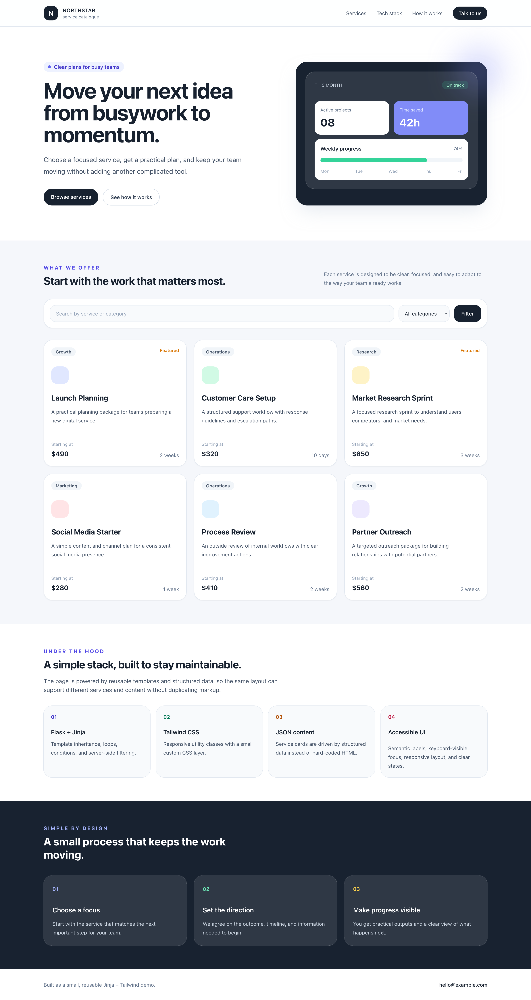

# Northstar Services — Jinja + Tailwind template demo

**🌐 Live Demo:** https://northstar-services-portfolio.onrender.com
> Free instance on Render may sleep after inactivity — first load can take ~30-50s.

A small, responsive service catalogue built to demonstrate structured frontend templating with **Flask, Jinja, Tailwind CSS, and JSON-driven content**.

[](https://github.com/zareiahmad1992-sketch/northstar-services-portfolio/blob/main/docs/homepage.png)

## What the project demonstrates

- Responsive HTML/CSS layout for desktop and mobile screens
- Tailwind CSS utility classes with a small custom CSS layer
- Jinja template inheritance using `base.html` and `index.html`
- Reusable Jinja loops, conditionals, and a service-card macro
- JSON-based content loaded from `data/services.json`
- Server-side search and category filtering with Flask
- Semantic HTML, accessible labels, and visible keyboard focus states
- Clear empty-state handling when a filter returns no results
- Simple, maintainable project structure with no duplicated card markup

## Tech stack

- **Python / Flask** — routing and server-side rendering
- **Jinja** — reusable templates and dynamic content
- **Tailwind CSS** — responsive styling and layout
- **JSON** — lightweight content/data source
- **HTML/CSS** — semantic and responsive UI
- **Gunicorn** — production WSGI server (Render)

## Project structure

```
northstar-services-portfolio/
├── app.py
├── data/
│   └── services.json
├── docs/
│   └── homepage.png
├── static/
│   └── css/
│       └── styles.css
├── templates/
│   ├── base.html
│   └── index.html
├── requirements.txt
├── Procfile
├── .gitattributes
└── README.md
```

## Run locally

```bash
python3 -m venv .venv
source .venv/bin/activate
python3 -m pip install -r requirements.txt
python3 app.py
```

Then open:

```
http://127.0.0.1:5000/
```

## QA Notes — How to test

Manual checks for this demo:

1. **Homepage** — 6 service cards load from `data/services.json` (prices, categories, durations visible)
2. **Search** — `GET /?q=Growth` filters by name/description/category (case-insensitive). Try `q=Growth` → 2 results
3. **Category filter** — `GET /?category=Operations` → 2 results, `All` returns all 6
4. **Empty state** — `GET /?q=xyz123` shows "No services found."
5. **Responsive** — check header nav collapses on mobile, cards stack correctly

## Design decisions

The service cards are intentionally loaded from JSON rather than hard-coded in the HTML. This makes the template easier to maintain and allows the same layout to support new services without changing the markup. The search and category filters are handled on the server through query parameters, keeping the example simple and easy to extend.

The interface uses semantic sections, form labels, clear focus states, responsive grids, and an explicit empty state to keep the experience understandable for different users and screen sizes.

## Deployment

The project includes a `Procfile` for platforms such as Render or Railway:

```
web: gunicorn app:app
```

The Flask app reads the `PORT` environment variable when it is available and binds to `0.0.0.0`, so it can run locally or on a cloud platform.

Live deployment: https://northstar-services-portfolio.onrender.com

## Possible next improvements

- Add a service details page using a dynamic slug
- Add a contact form with validation
- Move Tailwind from the browser CDN to a local production build
- Add automated tests for routes, filtering, and template rendering (Playwright + pytest)
- Add a CMS or API as the content source
